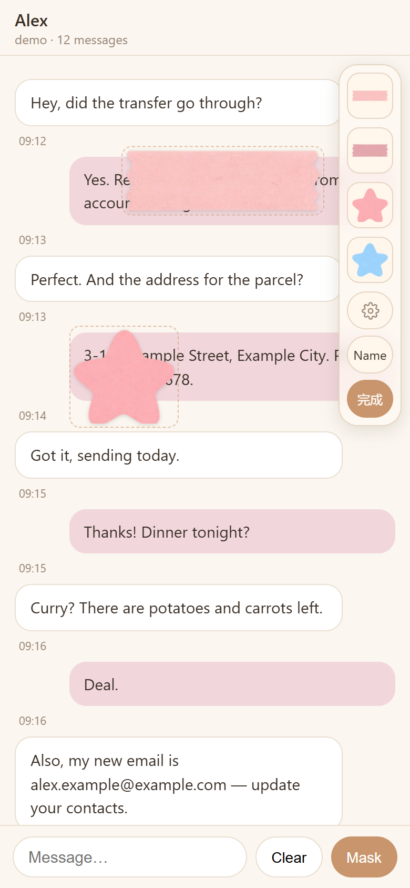

# sticker-mask

贴纸打码：截图之前，把贴纸盖在页面上要遮住的地方。手机上拖、捏、转、拉，点「完成」后把手全部消失，直接用系统截图。

Drop stickers over the parts of a page you want hidden, then take a normal screenshot. Touch-first (built for iOS Safari / PWA), works with a mouse too. No dependencies.

**[Demo](https://miya-tonya.github.io/sticker-mask/demo/)**（手机上打开试试 / open it on your phone） · 中文在上，English below.



贴纸素材请自行添加（演示里的胶带和星星是 AI 生成的）。Bring your own stickers — the tape and stars in the demo are AI-generated.

---

## 中文

### 它做什么

- 进入打码模式后，右侧出现一列素材；点一张就放到画面正中。
- **拖** = 移动；**角上的把手** = 缩放 + 旋转；**边上的小胶囊** = 单独拉宽 / 拉高；**×** = 删这一张。
- 贴纸内外**双指捏合**都能缩放旋转（贴纸小的时候在外面捏）。选中一张后**单指在空白处拖**也能移动它，轻点空白取消选中。
- 落在内容区的贴纸**跟着内容滚**；落在顶栏上的贴纸**钉住不动**。
- **完成** = 右侧列收起、所有把手和框消失，画面就是截图要的样子。贴纸只在本机内存里，不会发到任何地方。
- 可选的**贴纸管理**（齿轮）：分类 tab、上传（服务端裁透明边、压成 webp）、移出 / 移回素材列、移动分类、删除。需要接后端（见下）。

### 快速开始

```html
<link rel="stylesheet" href="sticker-mask.css">
<script src="sticker-mask.js"></script>
<script>
  const mask = StickerMask.create({
    scroller: document.querySelector("#messages"),  // 会滚动的内容区
    host: document.querySelector(".app"),           // 盖住整个界面（含顶栏）的定位祖先
    listUrl: "/stickers/list.json",                 // 素材清单
    sideTop: () => topbar.offsetHeight + 8,         // 右侧列离 host 顶边多远
    sideBottom: () => composer.offsetHeight + 8,
  });
  button.onclick = () => mask.enter();
</script>
```

`host` 需要 `position: relative`（或 absolute / fixed），并且包住顶栏和内容区；贴纸拖动中会挂到它上面，所以能盖住顶栏。`scroller` 如果是 `position: static` 会被自动改成 `relative`。

素材清单 `list.json`：

```json
{ "cats": ["胶带", "星星"],
  "items": ["/stickers/a.webp", { "src": "/stickers/b.webp", "cat": "星星" }, { "src": "/stickers/c.webp", "hidden": true }] }
```

纯数组 `["/stickers/a.webp", …]` 也行。

### 选项

| 选项 | 说明 |
|---|---|
| `scroller` *(必填)* | 内容滚动区 |
| `host` *(必填)* | 定位祖先，右侧列和顶层贴纸挂在这里 |
| `listUrl` / `assets` | 清单 URL，或直接给清单对象 |
| `api` | `{ upload, update, delete, cats }` 四个接口地址。不给就不显示齿轮，素材列只读 |
| `defaultCats` | 清单里没写 `cats` 时用的分类 |
| `sideTop` / `sideBottom` | 右侧列到 host 上下边的距离（数字或函数） |
| `extraButtons` | `[{ label, title, onClick, pressed }]`，放在「完成」上面的自定义键（比如顶栏名字开关） |
| `exitOn` | 选择器。打码模式下点到这些控件 = 先退出打码再让它照常响应。默认 `button, a, textarea, input, select, label` |
| `confirm` | `async ({ title, body, okText }) => boolean`，换成你自己的确认弹窗 |
| `texts` | 文案覆盖；`StickerMask.texts.en` 是整套英文 |
| `baseWidth` / `minWidth` / `maxWidth` | 初始宽 96，最小 = 初始的三分之一，最大 640 |
| `onChange(count)` / `onEnter()` / `onExit()` | 回调 |

### 实例方法

`enter()` `exit()` `toggle()` `clear()` `remount()` `openManager()` `reloadAssets()` `destroy()`，属性 `editing`、`count`。

**`remount()`**：如果你会整个重建 `scroller` 的内容（`innerHTML = ""`），重建之后调一下，贴纸层会挂回去。真发出一条消息、切换会话之类的时候，按你的需要调 `clear()`。

### 后端（可选）

`server/express-router.js` 是一份 Express 路由，依赖 `multer` 和 `sharp`：

```js
const stickerRouter = require("sticker-mask/server/express-router");
app.use("/api/stickers", stickerRouter({ dir: path.join(__dirname, "public/stickers") }));
```

- 上传：裁透明边 → 最长边 800 → webp q85，**永远用新文件名**（改素材不换名会被浏览器和 Service Worker 的缓存咬住）。
- 删除不真删，文件挪进回收目录；每次改 `list.json` 之前先存一份到归档目录。
- 路由本身**不做鉴权**，前面请自己加。

### 注意

- iOS 的状态栏（时间、电量）是系统层，贴纸盖不住；截完图再裁。
- 贴纸缩到很小时边把手会自动藏起来（会和角把手叠在一起），先放大再拉。
- 演示素材是 AI 生成的（胶带、星星），可随意使用。

---

## English

### What it does

- Enter mask mode and a column of stickers appears on the right; tap one to drop it in the middle of the view.
- **Drag** to move; **corner handle** scales + rotates; **edge pills** stretch width / height independently; **×** deletes.
- **Two-finger pinch** anywhere (inside or outside the sticker) scales + rotates the selected sticker. With a sticker selected, a **one-finger drag on empty space** moves it; a tap on empty space deselects.
- Stickers dropped on the content **scroll with it**; stickers dropped on the header **stay pinned**.
- **Done** hides the column and every handle — the page now looks the way you want it in a screenshot. Stickers live only in memory on the device.
- Optional **manager** (gear): category tabs, upload (server trims transparent edges and converts to webp), hide / show in the palette, move between categories, delete. Needs the server part.

### Quick start

```html
<link rel="stylesheet" href="sticker-mask.css">
<script src="sticker-mask.js"></script>
<script>
  const mask = StickerMask.create({
    scroller: document.querySelector("#messages"),  // the scrolling content area
    host: document.querySelector(".app"),           // positioned ancestor covering the whole UI
    listUrl: "/stickers/list.json",
    texts: StickerMask.texts.en,
    sideTop: () => topbar.offsetHeight + 8,
    sideBottom: () => composer.offsetHeight + 8,
  });
  button.onclick = () => mask.enter();
</script>
```

`host` must be positioned (relative / absolute / fixed) and contain both the header and the scroller; stickers are lifted onto it while being dragged, which is how they can cover the header. A `static` scroller is switched to `relative` automatically.

`list.json`:

```json
{ "cats": ["Tape", "Star"],
  "items": ["/stickers/a.webp", { "src": "/stickers/b.webp", "cat": "Star" }, { "src": "/stickers/c.webp", "hidden": true }] }
```

A plain array of URLs works too.

### Options

| Option | Description |
|---|---|
| `scroller` *(required)* | scrolling content element |
| `host` *(required)* | positioned ancestor; the side column and the floating layer mount here |
| `listUrl` / `assets` | list URL, or the list object itself |
| `api` | `{ upload, update, delete, cats }` endpoint URLs. Without it the gear is not shown and the palette is read-only |
| `defaultCats` | categories to use when the list has none |
| `sideTop` / `sideBottom` | distance (px or function) of the side column from the host's top / bottom edge |
| `extraButtons` | `[{ label, title, onClick, pressed }]` rendered above Done (e.g. a toggle that hides a name in your header) |
| `exitOn` | selector; tapping a matching control while editing exits mask mode first. Default `button, a, textarea, input, select, label` |
| `confirm` | `async ({ title, body, okText }) => boolean` to use your own confirm dialog |
| `texts` | string overrides; `StickerMask.texts.en` is a full English set |
| `baseWidth` / `minWidth` / `maxWidth` | initial width 96, minimum a third of that, maximum 640 |
| `onChange(count)` / `onEnter()` / `onExit()` | callbacks |

### Instance

`enter()` `exit()` `toggle()` `clear()` `remount()` `openManager()` `reloadAssets()` `destroy()`, plus `editing` and `count`.

Call **`remount()`** after you rebuild the scroller's content (`innerHTML = ""`), and `clear()` whenever the page changes in a way that makes the stickers meaningless (a message was sent, the conversation switched…).

### Server (optional)

`server/express-router.js` is an Express router that needs `multer` and `sharp`:

```js
const stickerRouter = require("sticker-mask/server/express-router");
app.use("/api/stickers", stickerRouter({ dir: path.join(__dirname, "public/stickers") }));
```

- Upload: trim transparent edges → longest side 800 → webp q85, **always under a new file name** (replacing an image under the same name gets stuck in browser / Service Worker caches).
- Delete moves the file to a trash folder; every change to `list.json` is archived first.
- The router does **no authentication** — put your own middleware in front.

### Notes

- The iOS status bar (clock, battery) is drawn by the system; stickers cannot cover it. Crop after the screenshot.
- Edge handles hide themselves on very small stickers (they would overlap the corner handles); scale up first.
- Demo stickers (tape, stars) are AI-generated; use them freely.

## License

MIT
